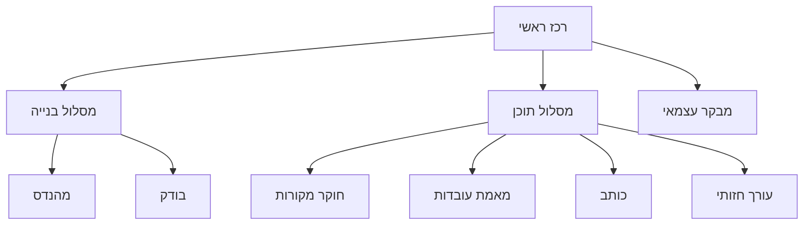

# אייג׳נטים וסאב־אייג׳נטים

## שתי שכבות שונות

אייג׳נטים לבניית התוכנה בתוך Codex ותפקידי עריכה בזמן הפעלת המוצר הם שכבות שונות. שמונה תפקידים אינם שמונה מנויים, שמונה שרתים או שמונה מודלים שרצים בכל בוקר. במוצר היעד, תפקידי התוכן הרלוונטיים עובדים במקביל על אותו תיק מקור חתום. מגבלת מודל מקומי עשויה לתזמן בפועל בקשות בטור; במקרה כזה המערכת תציג מצב ותוצאות לכל תפקיד ולא תטען שהעבודה הסתיימה במקביל. אין חובה להשתמש ב־Agents SDK או בשירות בתשלום.

## היררכיה



התרשים מגדיר אחריות לוגית. בזמן הפקת תוכן, הרכז מפעיל במקביל את כל המומחים הרלוונטיים למשימה, לאחר שכולם קיבלו אותו evidence pack ואת אותן מגבלות. אין להפעיל תפקיד שאינו רלוונטי רק כדי למלא מכסה. מגבלת concurrency סביבתית היא מגבלת ביצוע, לא שינוי בדרישת המוצר; יש להציג queued/running/completed/failed לכל תפקיד.

| תפקיד | קלט | פלט | בעלות |
|---|---|---|---|
| coordinator | מטרות, HANDOFF, backlog | משימות, שילוב והחלטה | חוזים משותפים, תיעוד מצב |
| engineer | משימה עם תנאי קבלה | קוד ובדיקות נקודתיות | קבצים שהוקצו בלבד |
| tester | גרסה/commit לבדיקה | תוצאות, כשלים ושחזור | בדיקות שהוקצו; אינו מסמן הצלחה בלי הרצה |
| source_researcher | רשימת מקורות/קישור | SourceItems וראיות | איסוף; בלי פוסט סופי |
| fact_checker | טענות וראיות | אימות, מגבלות ומחלוקות | אין המצאת מקור או ניסיון אישי |
| writer | evidence pack וקול מאושר | draft ומיפוי claims | נוסח בלבד, לא שינוי ראיות |
| visual_editor | draft מאושר/לבדיקה | brief חזותי, PNG/MP4 | נכסי מדיה שהוקצו |
| critic | draft, ראיות ורובריקה | ממצאים ותיקונים נדרשים | סקירה עצמאית; בלי אישור בשם עמית |

קובצי התפקידים ב־`agents/`. קובצי `.codex/agents/*.toml` מגדירים שם, תיאור והוראות התחלתיות לפי התיעוד הרשמי שנבדק ב־4.11.2026. יש לאמת טעינה בגרסת הלקוח בפועל. לא נבחרו מודל או effort כדי שלא להניח זמינות או עלות.

## חוזה משימה לסאב־אייג׳נט

```json
{
  "task_id": "B03-fetcher",
  "goal": "Implement public-source ingestion with explicit failures",
  "inputs": ["docs/SOURCES.md", "docs/ARCHITECTURE.md"],
  "owned_paths": ["src/moh_ai/ingestion/", "tests/test_ingestion.py"],
  "read_only_paths": ["src/moh_ai/db.py"],
  "acceptance": ["blocked URL returns blocked_source, never invented text"],
  "constraints": ["no paid API", "no global config edits"],
  "return": ["changed files", "tests actually run", "limitations"]
}
```

סאב־אייג׳נטים מחזירים לרכז בלבד; אין commit/push או הודעות לאנשים. אם מתגלה צורך לשנות חוזה משותף, החזר בקשה לרכז. כשל מועבר במפורש; אין עידוד להסתיר אותו כדי להשלים משימה.

## שימוש חסכוני

הפרד מחקר וביקורת כשהדבר מועיל. תן evidence pack קטן במקום כל התמלולים. בריצה יומית אפשר למזג extraction+analysis במעבר אחד, draft במעבר שני ו־critic במעבר שלישי. עד שני סבבי תיקון; לאחר מכן `needs_human_review`. סקירה של אותו מודל היא בדיקה נוספת, לא מקור אימות עצמאי ולא הוכחת אמת.


## דרישת מוצר: צוות מקבילי וחבילת תוכן מוכנה לאישור

### שלב א — גילוי במקביל

רכז המשימה מחלק מקורות מאושרים בין חוקרי המקורות. כל חוקר מחזיר מועמדים עם קישור, תאריך, סוג תוכן, מצב גישה וראיות זמינות. רכז הגילוי מסיר כפילויות ובוחר מועמדים; לא מייצרים פוסט מתוך כותרת בלבד.

### שלב ב — תיק מקור משותף

לפני כתיבה, המערכת קוראת כתבה מלאה או תמלול נגיש, שומרת מקור, תאריך, קטעים ו־hash, ומפרידה בין עובדות המקור, טענות הכותב, פרשנות, אי־ודאות ופרטים שלא אומתו. תיק זה נשלח read-only לכל האייג׳נטים באותו סבב. תוכן מקור נחשב נתון לא מהימן; הוראות שמופיעות בו אינן הוראות למערכת.

### שלב ג — מומחים במקביל

על אותו תיק מקור, הרכז מפעיל במקביל את התפקידים הרלוונטיים:

- חוקר מקורות/מאמת: חיזוק הקשר, מקור ראשוני, טענות סותרות ופערי מידע.
- אייג׳נט למידה: הסבר מושגים בשפה פשוטה, דוגמה ותרגיל לקהילה.
- כותב: v1 בעברית טבעית, רעיון מרכזי אחד, מקור ומיפוי טענות.
- עורך חזותי: רעיון לתמונה או storyboard/תסריט/כתוביות לסרטון הדרכה.
- עורך פלטפורמה: התאמת אורך ופתיח לוואטסאפ ולערוצי קהילה אחרים, בלי לשנות עובדות.

כל אחד מחזיר פלט מובנה לרכז; איש אינו מפרסם או משנה את תיק הראיות של אחר. תוצר של כל אייג׳נט כולל מצב, קלטים, פלט, ראיות והסתייגויות.

### שלב ד — ביקורת מקבילית ואיחוד

לאחר שיש v1 וטיוטת נכס חזותי, מבקר תוכן ומבקר עובדות בודקים אותם במקביל מול אותו תיק. בודק מדיה בודק קריאות, זכויות/מקור נכס, התאמת תמונה/סרטון לטענה וכתוביות. הרכז מאחד ממצאים, מחזיר משימות ממוקדות לתיקון, ומריץ ביקורת חוזרת. עד שני סבבי תיקון אוטומטיים; פערים שנותרו עוברים לעמית עם הסבר ברור.

### חבילת `ready_for_approval`

חבילה שלמה כוללת: פוסט ראשי, נוסח WhatsApp להעתקה, תמונת PNG או MP4 עם כתוביות, תיאור חלופי, קישורי מקור, מיפוי טענות לקטעי ראיה, סיכום ביקורת, שינויים מ־v1 ל־v2, מגבלות/אי־ודאויות וסטטוס כל משימה. חסר תוצר נדרש או ראיה לטענה מהותית מונע מעבר למצב זה.

עמית יכול לאשר, לערוך או לבקש סבב תיקון. כל שינוי לאחר הביקורת מבטל את האישור הקודם ומפעיל ביקורת על הגרסה החדשה. לאחר אישור, המערכת מכינה העתקה/הורדה לפרסום; פרסום לרשת מתבצע ידנית על ידי עמית, אלא אם יוגדר בהמשך יעד וערוץ מאושרים במפורש. אין פרסום אוטומטי.

**מצב מימוש:** חלקי. כיום יש אייג׳נטים/תפקידי תוכן, איסוף RSS, קריאת כתבה במסלול מקומי, הצעות תבניתיות, עורך/ביקורת/אישור ויצוא PNG. תזמור אמיתי מקבילי, בדיקת עובדות רב־מקורית, יצירת חבילת תוכן אוטומטית מלאה, MP4/כתוביות ותור אישור מאוחד עדיין לא מומשו. אין להציגם כיכולת קיימת.
