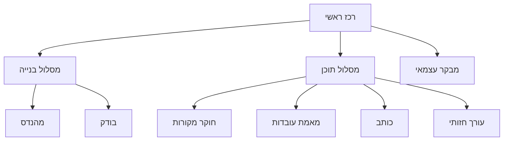

# אייג׳נטים וסאב־אייג׳נטים

## שתי שכבות שונות

אייג׳נטים לבניית התוכנה בתוך Codex ותפקידי עריכה בזמן הפעלת המוצר הם שכבות שונות. שמונה תפקידים אינם שמונה מנויים, שמונה שרתים או שמונה מודלים שרצים בכל בוקר. במסלול המקומי תפקידי התוכן יכולים להיות קריאות סדרתיות לאותו מודל. אין חובה להשתמש ב־Agents SDK או ליצור סאב־אייג׳נט לכל פעולה.

## היררכיה



התרשים הוא אחריות לוגית. בפועל עד שני סאב־אייג׳נטים פעילים, ללא ספאון אוטומטי של כל העץ. ברירת המחדל היא האצלה ברמה אחת; סאב־אייג׳נט לא מאציל הלאה בלי צורך שהרכז תיעד.

| תפקיד | קלט | פלט | בעלות |
|---|---|---|---|
| coordinator | מטרות, HANDOFF, backlog | משימות, שילוב והחלטה | חוזים משותפים, תיעוד מצב |
| engineer | משימה עם תנאי קבלה | קוד ובדיקות נקודתיות | קבצים שהוקצו בלבד |
| tester | גרסה/commit לבדיקה | תוצאות, כשלים ושחזור | בדיקות שהוקצו; אינו מסמן הצלחה בלי הרצה |
| source_researcher | רשימת מקורות/קישור | SourceItems וראיות | איסוף; בלי פוסט סופי |
| fact_checker | טענות וראיות | אימות, מגבלות ומחלוקות | אין המצאת מקור או ניסיון אישי |
| writer | evidence pack וקול מאושר | draft ומיפוי claims | נוסח בלבד, לא שינוי ראיות |
| visual_editor | draft מאושר/לבדיקה | brief חזותי, PNG/MP4 | נכסי מדיה שהוקצו |
| critic | draft, ראיות ורובריקה | ממצאים ותיקונים נדרשים | סקירה עצמאית; בלי אישור בשם עמית |

קובצי התפקידים ב־`agents/`. קובצי `.codex/agents/*.toml` מגדירים שם, תיאור והוראות התחלתיות לפי התיעוד הרשמי שנבדק ב־4.11.2026. יש לאמת טעינה בגרסת הלקוח בפועל. לא נבחרו מודל או effort כדי שלא להניח זמינות או עלות.

## חוזה משימה לסאב־אייג׳נט

```json
{
  "task_id": "B03-fetcher",
  "goal": "Implement public-source ingestion with explicit failures",
  "inputs": ["docs/SOURCES.md", "docs/ARCHITECTURE.md"],
  "owned_paths": ["src/moh_ai/ingestion/", "tests/test_ingestion.py"],
  "read_only_paths": ["src/moh_ai/db.py"],
  "acceptance": ["blocked URL returns blocked_source, never invented text"],
  "constraints": ["no paid API", "no global config edits"],
  "return": ["changed files", "tests actually run", "limitations"]
}
```

סאב־אייג׳נטים מחזירים לרכז בלבד; אין commit/push או הודעות לאנשים. אם מתגלה צורך לשנות חוזה משותף, החזר בקשה לרכז. כשל מועבר במפורש; אין עידוד להסתיר אותו כדי להשלים משימה.

## שימוש חסכוני

הפרד מחקר וביקורת כשהדבר מועיל. תן evidence pack קטן במקום כל התמלולים. בריצה יומית אפשר למזג extraction+analysis במעבר אחד, draft במעבר שני ו־critic במעבר שלישי. עד שני סבבי תיקון; לאחר מכן `needs_human_review`. סקירה של אותו מודל היא בדיקה נוספת, לא מקור אימות עצמאי ולא הוכחת אמת.
