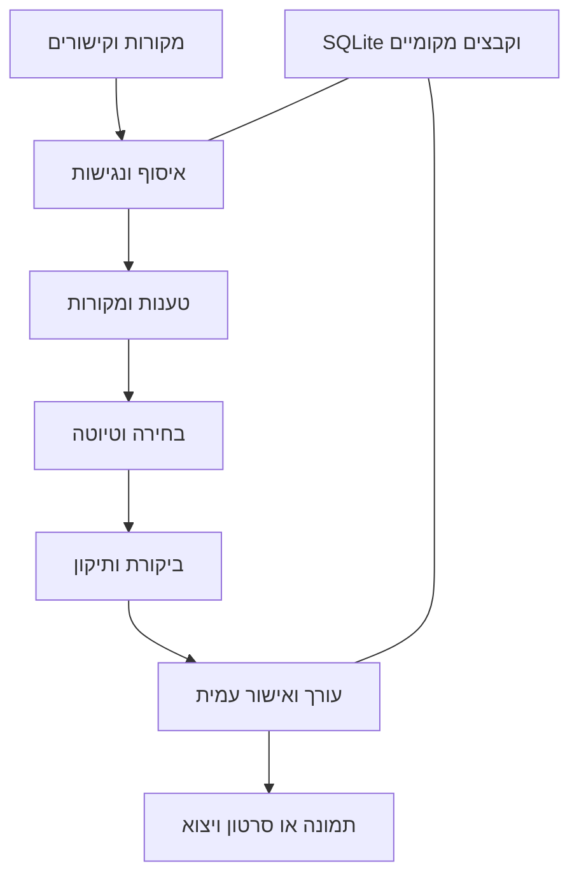

# ארכיטקטורה וחוזי נתונים

## הבחירה המומלצת

גרסה מקומית קטנה: backend ב־Python, SQLite, דפי HTML עם RTL ו־JavaScript מינימלי, תהליך איסוף עצמאי, adapter למודל מקומי, תהליך מדיה נפרד. FastAPI/Jinja, Playwright ו־FFmpeg הם מועמדים; יש לבדוק גרסאות, רישוי ותאימות לפני נעילה. אין צורך ב־LangChain, שירות תורים ענני, מסד וקטורי או Agents API בתשלום.

רכיבי Python פנימיים מבצעים את אותה לוגיקה עבור UI, CLI ו־MCP. אין לשכפל ניתוח או כללי אימות בשלוש שכבות.



## מבנה יעד לאחר הבנייה

```text
src/moh_ai/
  cli.py, config.py, db.py
  ingestion/, evidence/, ranking/, generation/
  workflows/, media/, web/, mcp_server/
tests/
config/sources.json
config/settings.example.json
assets/fonts/, assets/templates/
data/                       # private, ignored by git
runs/                       # private logs, ignored by git
exports/                    # private by default
```

אלה שמות יעד; הקוד טרם נכתב. Codex יכול להתאים את המבנה תוך תיעוד החלטה, בלי לשנות את חוזי ההתנהגות.

## רשומות

| ישות | שדות מחייבים |
|---|---|
| Source | id, kind, url, enabled, language, permissions_note, access_status, checked_at |
| SourceItem | id, source_id, canonical_url, title, published_at nullable, retrieved_at UTC, content_hash, content_path, access_status, analysis_basis, language, raw_origin |
| Claim | id, item_id, statement, evidence_locator, evidence_excerpt_short, verification_status, primary_source_url nullable, uncertainty |
| Candidate | id, run_id, item_ids, claim_ids, angle, category, score_breakdown, exclusion_reason nullable |
| Draft | id, candidate_id, version, text, voice_profile_version, claim_map, status, reviewer_report_id nullable |
| Review | id, draft_id, findings, scores, must_fix, revised_draft_id nullable, reviewer_identity |
| Asset | id, draft_id, kind, file_path, checksum, rights_note, render_status, width, height, duration nullable |
| Run | id, local_service_date, timezone, started_at, completed_at nullable, status, errors, counts, model_mode, source_set_hash |
| Approval | id, draft_id, draft_version, asset_checksums, approved_at, actor |

`analysis_basis`: full_text / transcript / audiovisual / description_only / user_supplied. `access_status`: pending / accessible / partial / needs_transcript / blocked / failed. `verification_status`: primary_confirmed / corroborated / source_claim_only / disputed / unknown. אין לתת למודל לשנות סטטוס אימות בלי ראיה.

## מיפוי טענות

`claim_map` מקשר טווח או משפט ב־draft ל־claim_ids. דעה או דוגמה מומצאת לצורכי הסבר מסומנת ככזו. טענה מהותית לא ממופה חוסמת סטטוס ready_for_approval. כתבה שמצטטת כתבה אחרת אינה שני מקורות עצמאיים.

## מעברי מצב

`collected → analyzed → shortlisted → drafted → reviewed → ready_for_approval → approved → exported`.

ענפים מפורשים: blocked_source, awaiting_model, needs_revision, render_failed. שינוי נוסח אחרי אישור מחזיר ל־reviewed/needs_revision ומבטל אישור קודם. כל שינוי מדיה מבטל התאמה ל־checksum המאושר. יצוא טיוטה מותר עם סימון draft; חבילת final דורשת אישור לגרסה ולנכסים הנוכחיים.

## עמידות

עסקאות SQLite קצרות, כתיבת קבצים אטומית, unique ל־canonical_url/content_hash לצמצום כפילות; לשמור שינויי תוכן כגרסאות ולא לדרוס ראיות. נעילה לריצת daily לפי תאריך מקומי וסוג ריצה. רענון ידני מקבל run_id אחר ומבצע dedupe של candidates. שגיאת מקור אחד אינה מפילה את שאר הריצה. תשובה לא תקינה מהמודל מקבלת תיקון מוגבל אחד ולא לולאה.

## הגנת מידע

bind ל־127.0.0.1, אין remote scripts בתצוגת תוכן, escape ל־HTML, allowlist של קבצי יצוא. ב־fetch חסום כתובות private/link-local/loopback ו־file URLs, בדוק redirects ופתרון DNS מחדש כדי למנוע SSRF. exception מוגדר למודל המקומי בלבד; אין להשתמש ב־fetcher הציבורי לגישה אליו. הגבל גודל, timeout וסוג קובץ. בלי ביצוע קוד שמקורו בכתבה.
